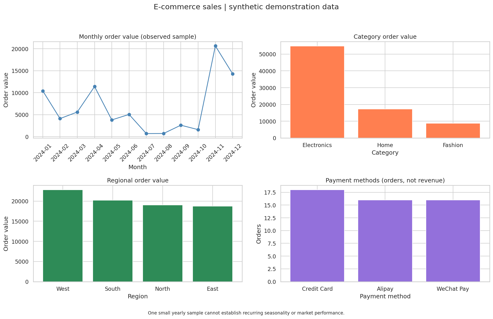

# Data Analytics Skills · 电商数据分析作品集

面向数据分析求职的 5 个小型展示项目：从业务问题、指标口径和数据检查，到可复算结果、可视化及分析边界。

> **数据声明：** 所有 CSV 都是人工构造的合成教学数据，不来自真实企业，不代表本人真实工作业绩。小样本仅用于演示方法，不应外推市场规律或编造业务提升。

## 项目导航

| 项目 | 业务问题 / 展示技能 | 可直接查看 |
|---|---|---|
| [电商销售分析](projects/ecommerce-sales-analysis/README.md) | 月度销售、客单价、类别/地区表现 | [已执行笔记本](projects/ecommerce-sales-analysis/notebooks/sales_analysis.ipynb) · [看板](projects/ecommerce-sales-analysis/output/sales_dashboard.png) |
| [用户行为分析](projects/user-behavior-analysis/README.md) | 同一会话的有序去重漏斗、设备差异、日活 | [已执行笔记本](projects/user-behavior-analysis/notebooks/behavior_analysis.ipynb) · [看板](projects/user-behavior-analysis/output/behavior_dashboard.png) |
| [营销活动评估](projects/marketing-campaign-evaluation/README.md) | 加权 CTR / CPA / ROAS、变体描述性比较 | [已执行笔记本](projects/marketing-campaign-evaluation/notebooks/campaign_analysis.ipynb) · [看板](projects/marketing-campaign-evaluation/output/campaign_dashboard.png) |
| [客户细分](projects/customer-segmentation/README.md) | 可解释 RFM 分层、标准化、K-Means 画像 | [已执行笔记本](projects/customer-segmentation/notebooks/segmentation_analysis.ipynb) · [看板](projects/customer-segmentation/output/segmentation_dashboard.png) |
| [购物篮与商品相似度](projects/product-recommendation-analysis/README.md) | Support / Confidence / Lift、商品余弦相似度 | [已执行笔记本](projects/product-recommendation-analysis/notebooks/recommendation_analysis.ipynb) · [看板](projects/product-recommendation-analysis/output/recommendation_dashboard.png) |



## 已实现的技能

- pandas 数据检查、分组聚合和指标复算。
- 区分事件、用户与会话；明确分子、分母和分析窗口。
- Matplotlib / Seaborn 可视化，支持无图形界面的批量执行。
- scikit-learn 标准化、聚类和相似度计算。
- 分析逻辑模块化复用，Jupyter 展示表格、图表和结论边界。
- 单元测试、脚本 smoke test、独立内核执行 notebook、GitHub Actions 验证。

**没有宣称实现的内容：** SQL 实战、随机 A/B 实验与显著性检验、CLV/流失预测、推荐离线指标或真实线上业务提升。后续可作为独立迭代补充，而不是当作已完成成果。

## 快速开始（Python 3.11）

以下命令在仓库根目录执行。依赖直接版本固定在 [requirements.txt](requirements.txt)。

已完成 Windows / Python 3.11 的[全新隔离环境安装验证](reports/installation.md)，包括依赖检查、29 项单元测试以及全部脚本和笔记本执行。

### Windows PowerShell

```powershell
python -m venv .venv
.\.venv\Scripts\python.exe -m pip install -r requirements.txt
.\.venv\Scripts\python.exe -m unittest discover -s tests -v
.\.venv\Scripts\python.exe scripts/validate_portfolio.py
```

建议使用独立虚拟环境安装依赖，避免与其他项目的包版本冲突。

### macOS / Linux

```bash
python3.11 -m venv .venv
.venv/bin/python -m pip install -r requirements.txt
.venv/bin/python -m unittest discover -s tests -v
.venv/bin/python scripts/validate_portfolio.py
```

统一验证器会重新运行 5 个脚本、执行 5 本 notebook 的全部单元，并生成 [Markdown 验证报告](reports/validation.md) 和 [JSON 记录](reports/validation.json)。它显式使用当前 Python 创建私有内核，不依赖系统的默认 Jupyter 内核。使用 `--scripts-only` 可跳过 notebook，报告会明确标为 `skipped`。

### 交互查看笔记本

```powershell
.\.venv\Scripts\python.exe -m ipykernel install --prefix .venv --name python3 --display-name "Python (data-analytics-skills)"
.\.venv\Scripts\python.exe -m notebook
```

在仓库内部启动 Jupyter，选择 `Python (data-analytics-skills)`。笔记本会从当前目录向上定位项目，不使用 notebook 中不存在的 `__file__`。

## 复用和维护

- 各项目的 `scripts/analyze.py` 提供 `load_data()`、`analyze(df)`、`plot_dashboard(results)`；直接执行脚本才向 `output/` 写结果。
- [笔记本生成器](scripts/build_notebooks.py) 用于更新 notebook 内容；运行它会清除旧执行结果，之后必须再次执行统一验证器。
- [测试](tests/test_analysis.py) 检查关键指标、重复事件、时间顺序、重复分值和空关联规则等情况。
- [.gitignore](.gitignore) 排除虚拟环境、下载工具、凭据、本地日志及 R 历史；合成数据、结果 CSV、PNG 和已执行 notebook 保留在仓库内。
- [自动验证配置](.github/workflows/validate.yml) 在 GitHub 推送 / Pull Request 后运行；本地执行通过不代表远端 CI 已运行。

## 发布到 GitHub

请按 [发布说明](docs/PUBLISHING.md) 登录 GitHub、选择公开范围并推送。本地 Git 初始化或提交成功不等于 GitHub 上已建库；以实际远端 URL 和推送结果为准。

## 许可证

本仓库的代码、文档与合成示例数据采用 [MIT License](LICENSE)。复用时请保留许可证及版权声明。

## 面试时如何介绍

先讲一个业务问题，再解释指标与数据质量，展示可复算的表格和看板，最后说明数据限制和下一步如何验证。可以说“完成了 5 个合成电商数据分析练习”，不要将它们包装成真实公司经历或未经验证的增长成果。
